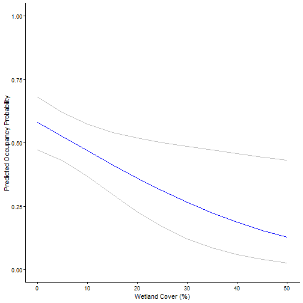
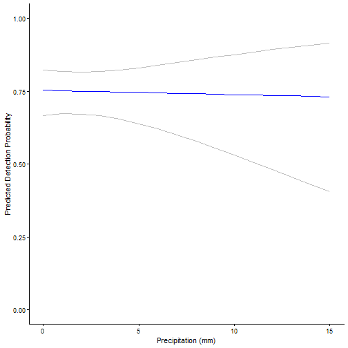
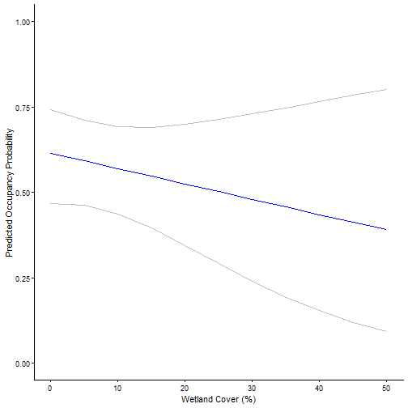
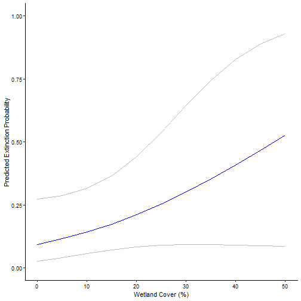
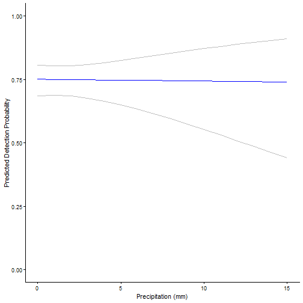

# Chapter 9: Using NatureCounts alongside 'unmarked' occupancy models

##### Author: Rory Macklin

The past eight chapters of the NatureCounts Covariate Download and Extraction Tutorial have demonstrated workflows for gathering covariate data and pairing it to observation data from NatureCounts. Ultimately, data like these are often used as predictor variables in a variety of model types aiming to predict the occurrence of a species. Here, we demonstrate one example of how the covariate functions within the `naturecounts` R package can fit into common modeling workflows from the [`unmarked`](https://cran.r-project.org/web/packages/unmarked/index.html) R package.

`unmarked` contains a variety of useful modeling structures applicable to a wide swathe of survey approaches, many of which allow for the estimation of covariate effects. We hope this tutorial will serve as a useful starting point for those looking to investigate the effects of environmental covariates on the detection probability and occurrence of their study species.

This tutorial assumes you have a basic understanding of working with spatial data in R. For a good introduction to these kinds of operations, the [NatureCounts Spatial Data Tutorial](https://github.com/BirdsCanada/NatureCounts_SpatialData_Tutorial) can serve as a useful starting point. It explains how to download, process, and visualize spatial data, including NatureCounts surveys, conservation areas, and environmental layers. This tutorial also uses functions demonstrated throughout the [NatureCounts Covariate Download and Extraction Tutorial](https://birdscanada.github.io/naturecounts/articles/#the-naturecounts-covariate-download-and-extraction-tutorial). If you are unfamiliar with these functions, we recommend using the previous tutorials to learn to use these download and extraction functions.

# 9.0 Learning Objectives

By the end of **Chapter 9 - Using NatureCounts alongside 'unmarked' occupancy models**, users will:

- Have a basic understanding of the structure of single-year static and multi-year dynamic occupancy models included in the `unmarked` package: [Occupancy Models in `unmarked`](#9.1unmarked).
- Download and extract a variety of covariate data for use in `unmarked` occupancy models using the `naturecounts` R package: [Downloading and Extracting Covariate Data](#9.2covariates).
- Format observation and covariate data for use with `unmarked` single-season occupancy models: [Formatting Data for `unmarked` Single-season Occupancy Models](#9.3occu).
- Format observation and covariate data for use with `unmarked` multi-season dynamic occupancy models: [Formatting Data for `unmarked` Multi-season Dynamic Occupancy Models](#9.4colext).

This R tutorial requires the following packages:

``` r
library(naturecounts)
library(tidyverse)
library(sf)
library(terra)
library(unmarked)
```

# 9.1 Occupancy Models in `unmarked` {#9.1unmarked}

The [`unmarked`](https://cran.r-project.org/web/packages/unmarked/index.html) R package contains a wide variety of useful modeling tools to investigate species occupancy. These models are generally built for use with surveys that do not rely on explicit mark-recapture methods, instead requiring repeat visits to a site and assumptions allowing the estimation of "detection probability". This critical parameter accounts for a core problem in ecological surveys - imperfect detection.

Despite an individual of a species being present during a survey, they may go undetected for a number of reasons. The individual may not make any detectable signal to the observer (e.g., singing, moving), rendering detection impossible. Even if a signal is made, an observer may fail to detect it, perhaps due to interfering noise (e.g., from high winds) or the individuals position relative to the observer (e.g., the individual may be at the edge of the survey area and therefore harder to spot). These missed detections, if left unaddressed, can severely bias model outcomes.

Occupancy models in `unmarked` typically address this issue by requiring repeated visits to a site within a period of assumed "population closure". During this period, it is assumed that the true occupancy state of a site is static (i.e., the site is either truly occupied or unoccupied during the entire closure period). Based on the detection data from a site visited multiple times, the true occupancy state for that site that maximizes model likelihood is selected, and detection data inconsistent with this state is used to estimate detection probability. These models are quite sensitive to this assumption, so choosing a reasonable period of closure within which you can expect the occupancy state of site to remain constant is important.

For example, if the detection data at a site produces a model with maximum likelihood that suggests that the site is truly occupied, then visits where the species goes undetected are treated as missed detections, and the factors contributing to the failure to detect the species on that visit can be modeled and their effect estimated. Other methods for estimating detection probability exist and are available within `unmarked` (e.g. distance sampling, time removal sampling), but are not discussed here. These frequentist models can also be extended into a Bayesian framework using the [`ubms` package](https://cran.r-project.org/web/packages/ubms/index.html).

In this tutorial, we will demonstrate the application of two types of `unmarked` occupancy models using data from the [British Columbia Marsh Monitoring Program](https://naturecounts.ca/nc/bcmmp/main.jsp) (BCMMP). First, we demonstrate the single-season occupancy model of [Mackenzie et al. (2002)](https://doi.org/10.1890/0012-9658(2002)083%5B2248:ESORWD%5D2.0.CO;2). This model is one of the most widely applied occupancy frameworks for surveys with a single period of closure looking to estimate occupancy probabilities corrected for imperfect detection. Next, we demonstrate the multi-season dynamic occupancy model of [Mackenzie et al. (2003)](https://doi.org/10.1890/02-3090). This model incorporates the estimation of transition probabilities between multiple periods of closure, making it applicable to surveys where a site is visited multiple times within a period of closure and is then not visited again for a time during which the site's true occupancy state may change before another period of closure (e.g., annual surveys).

# 9.2 Downloading and Extracting Covariate Data {#9.2covariates}

Both the single- and multi-season models we will demonstrate allow for the incorporation of covariates on the processes of species occurrence and detection. We will use the `naturecounts` R package to gather these covariates.

First, we will download data from the BCMMP from NatureCounts. To do so, a request must be placed through the [NatureCounts Web Portal](https://naturecounts.ca/nc/default/main.jsp). This requires a NatureCounts account, which can be made [here](https://naturecounts.ca/nc/default/register.jsp). Once a request has been placed and approved, you can use `nc_data_dl()` to download your data and load it into your R environment.

``` r
# Download BCMMP using your NatureCounts username and request ID.
bcmmp <- nc_data_dl(username = "Your NatureCounts Username", 
                    request_id = "Your Request ID",
                    fields_set = "minimum")
```

Sites in the BCMMP are visited twice annually during the breeding season. We will assume that the true occupancy state of a site is fixed during the breeding season (i.e., our period of population closure), but may change between breeding seasons (i.e. a site occupied in one year is not necessarily occupied during the next year). These models are designed to work with data from a single species, so we will choose a well detected species for the purposes of demonstration - the Common Yellowthroat (*Geothlypis trichas*).

As a first step of data cleaning, we will ensure that we are only retaining data at sites with valid location data that are visited exactly two times within a year.

``` r
# Only retain surveys from 2021-2025 to align with eventual covariate availablilty.
bcmmp <- filter(bcmmp, survey_year %in% 2021:2025)

# Remove surveys with missing latitude/longitude information.
bcmmp <- filter(bcmmp, !(is.na(latitude) | is.na(longitude)))

# Identify any cases where two surveys were done on the same day.
bcmmp %>% 
  group_by(SurveyAreaIdentifier, survey_year, survey_month, survey_day) %>% 
  summarize(n_surveys = length(unique(SamplingEventIdentifier))) %>% 
  filter(n_surveys > 1)
#> # A tibble: 6 × 5
#> # Groups:   SurveyAreaIdentifier, survey_year, survey_month [5]
#>   SurveyAreaIdentifier survey_year survey_month survey_day n_surveys
#>   <chr>                      <int>        <int>      <int>     <int>
#> 1 CO-WC-MBS03-1               2023            6         23         2
#> 2 LM-SA-control-MB02-1        2022            6         27         2
#> 3 PIAM-7-1                    2022            6          1         2
#> 4 PIAM-7-1                    2022            6         21         2
#> 5 SC-PSRP-2-1                 2024            6         16         2
#> 6 TN_TN1-1                    2023            6         18         2

# Remove one survey on each double-surveyed day. We'll remove the first one of
# each day assuming that the second was done due to some error in the first.
remove <- c("BCMMP_BIRDS-504903-1",
            "BCMMP_BIRDS-359443-1",
            "BCMMP_BIRDS-312288-1",
            "BCMMP_BIRDS-326448-1",
            "BCMMP_BIRDS-623861-1",
            "BCMMP_BIRDS-438470-1")

bcmmp <- filter(bcmmp, !(SamplingEventIdentifier %in% remove))

# Create an object containing the number of visits to a site in each year it is
# surveyed. We can use the unique SamplingEventIdentifier assigned to each
# sampling occasion to do this.
surveys <- bcmmp %>%
  group_by(SurveyAreaIdentifier, survey_year) %>%
  summarize(n_visits = length(unique(SamplingEventIdentifier)))
  
# We will add a column to our surveys object identifying what we should do with
# each site-year combination. "remove" for undersampled site-year combinations
# where n_visits = 1, "keep" for site-year combinations with n_visits = 2,
# "fix" when n_visits > 2.
surveys <- mutate(surveys, SurveyedCorrectly = case_when(n_visits == 1 ~ "remove",
                                                         n_visits == 2 ~ "keep",
                                                         n_visits > 2 ~ "fix")) %>%
  select(-n_visits)

# We'll now append this column to our original BCMMP object and use it to filter
# out site-year combinations with only one survey.
bcmmp <- left_join(bcmmp, surveys, by = c("SurveyAreaIdentifier", "survey_year")) %>%
  filter(!(SurveyedCorrectly == "remove"))

# We'll take a look at the site-year combinations that are oversampled and
# manually decide which SamplingEventIdentifiers to remove. We will try to
# select surveys that are as close together as possible (but not overlapping)
# in order to best match our assumption of population closure, but at least
# 10 days apart to match the BCMMP protocol.
bcmmp %>% 
  filter(SurveyedCorrectly == "fix") %>% 
  select(SurveyAreaIdentifier, SamplingEventIdentifier, survey_year, survey_month, survey_day, TimeCollected) %>%
  arrange(SurveyAreaIdentifier, survey_year, survey_month, survey_day, TimeCollected) %>% 
  distinct()
#>     SurveyAreaIdentifier SamplingEventIdentifier survey_year survey_month survey_day TimeCollected
#> 1               BELA-1-1    BCMMP_BIRDS-449787-1        2023            5         12       19.9333
#> 2               BELA-1-1    BCMMP_BIRDS-404051-1        2023            5         18          20.1
#> 3               BELA-1-1    BCMMP_BIRDS-432639-1        2023            6         15       20.3333
#> 4               BELA-2-1    BCMMP_BIRDS-449792-1        2023            5         12       20.5333
#> 5               BELA-2-1    BCMMP_BIRDS-404048-1        2023            5         18       19.8167
#> 6               BELA-2-1    BCMMP_BIRDS-432638-1        2023            6         15          20.1
#> 7       KO - CWSP RAND-1    BCMMP_BIRDS-876994-1        2025            5         26       8.23333
#> 8       KO - CWSP RAND-1    BCMMP_BIRDS-877000-1        2025            6         11          8.05
#> 9       KO - CWSP RAND-1    BCMMP_BIRDS-877001-1        2025            6         22           8.3
#> 10 OK-VC-control-MBS01-1    BCMMP_BIRDS-503089-1        2023            5         26       7.66667
#> 11 OK-VC-control-MBS01-1    BCMMP_BIRDS-503092-1        2023            5         29       20.7833
#> 12 OK-VC-control-MBS01-1    BCMMP_BIRDS-503296-1        2023            6         19       7.71667
#> 13              PSRP-1-1    BCMMP_BIRDS-448264-1        2023            5         11       7.88333
#> 14              PSRP-1-1    BCMMP_BIRDS-448312-1        2023            6          6       8.33333
#> 15              PSRP-1-1    BCMMP_BIRDS-448329-1        2023            6         26       8.16667
#> 16              PSRP-2-1    BCMMP_BIRDS-448292-1        2023            5         11       7.16667
#> 17              PSRP-2-1    BCMMP_BIRDS-448302-1        2023            6          6       7.91667
#> 18              PSRP-2-1    BCMMP_BIRDS-448320-1        2023            6         26       7.41667
#> 19           SC-PSRP-1-1    BCMMP_BIRDS-183574-1        2021            5          2          8.25
#> 20           SC-PSRP-1-1    BCMMP_BIRDS-190574-1        2021            5         13           7.5
#> 21           SC-PSRP-1-1    BCMMP_BIRDS-190759-1        2021            5         23       7.33333
#> 22           SC-PSRP-2-1    BCMMP_BIRDS-623849-1        2024            5         23          7.25
#> 23           SC-PSRP-2-1    BCMMP_BIRDS-623863-1        2024            6         16       8.66667
#> 24           SC-PSRP-2-1    BCMMP_BIRDS-623866-1        2024            6         24           7.5

remove <- c("BCMMP_BIRDS-449787-1", 
            "BCMMP_BIRDS-449792-1", 
            "BCMMP_BIRDS-877001-1",
            "BCMMP_BIRDS-503089-1",
            "BCMMP_BIRDS-448264-1",
            "BCMMP_BIRDS-448320-1",
            "BCMMP_BIRDS-183574-1",
            "BCMMP_BIRDS-623866-1")

# Now we'll filter out all of the selected surveys and confirm that all sites
# are visited twice in each year they are surveyed.
bcmmp <- filter(bcmmp, !(SamplingEventIdentifier %in% remove))

surveys <- bcmmp %>%
  group_by(SurveyAreaIdentifier, survey_year) %>%
  summarize(n_visits = length(unique(SamplingEventIdentifier)))

unique(surveys$n_visits)
#> [1] 2
```

Now that we have completed some basic cleaning of the BCMMP dataset, we can extract the columns we will need for our analysis and zero-fill the dataset, identifying visits to sites where Common Yellowthroat were and were not detected. We will use the `species_id` column to identify observations of Common Yellowthroat, which are represented with the ID `17000` (we can find this information using `meta_species_taxonomy()`).

``` r
# Grab all columns containing all necessary survey information and convert to
# dataframe with a row for each sampling event.
yellowthroat <- select(bcmmp, SamplingEventIdentifier, SurveyAreaIdentifier, latitude, longitude, survey_year, survey_month, survey_day, TimeCollected) %>%
  distinct()

# Loop across each SamplingEventIdentifier and check whether Common Yellowthroat
# were detected in during that survey. If so, fill the new column "detected"
# with a 1. If not, set detected = 0.

for(i in yellowthroat$SamplingEventIdentifier) {
  yellowthroat$detected[yellowthroat$SamplingEventIdentifier == i] <- ifelse(17000 %in% bcmmp$species_id[bcmmp$SamplingEventIdentifier == i], 1, 0)
}
```

With our BCMMP data organized into a presence-absence dataset for Common Yellowthroat, we can now think about the covariates we would like to use in our models. We can get an idea of the covariates available through the `naturecounts` R package using `nc_covariate_table()`.

In the context the occupancy modeling we plan to do down the line, we can consider three types of covariates. First, we can consider covariates that do not change over time. `unmarked` refers to these as site covariates. Covariates that do change between periods of closure (in our case, can change year-to-year) but not within a period of closure are referred to as yearly site covariates. Covariates that change between visits to a site within a closure period are referred to as observation covariates, and are typically only used in the estimation of detection probability.

Since we have samples from the low coastal regions of British Columbia and into the higher mountainous areas of the interior, we will select elevation as a covariate as it will be highly variable between sites and may drive distributional patterns. As elevation doesn't change over time (at least the time scales we care about in this analysis), this would be considered a site covariate.

We will also choose to assess the landcover in the area surrounding each survey. We might expect that areas with greater availability of wetlands in the surrounding landscape may be more suitable for Common Yellowthroat as more habitat may be available. We will use the annual-scale MODIS landcover dataset to assess the cover of this landcover type at each site. As wetland cover may change between years (i.e. between closure periods) but won't change between visits to a site within a breeding season this is considered a yearly site covariate.

Finally, we may expect that it is harder to detect Yellowthroat on surveys taking place on rainy days, even if they are there, as visibility may be reduced and songs may be masked by the noise from the rain leading to missed detections. We can use the daily-scale Daymet weather dataset to assess how rainy it was at each site on the day it was surveyed. As this value can change between sampling events within a period of closure, this would be considered an observation covariate.

Let's use the functions in the `naturecounts` R package to download and extract these data.

``` r
# First, we'll use data_fmt() to format our data into the format necessary for 
# covariate download and extraction. We can ignore the warning as EPSG:4326 is
# an appropriate coordinate reference system for our data.
formatted <- data_fmt(yellowthroat)
#> [Data Formatting] beginning formatting.
#> Warning: [Data Formatting] as the 'crs' argument is not specified, data CRS is assumed to be EPSG:4326.

# We'll buffer our data out by a radius of 500m to capture the surrounding
# landscape.
buffered <- data_buff(formatted)
#> [Data Buffering] buffering sites by 500m radius (default).

# With the data formatted as needed, we'll download elevation data using
# elevation_download(). We'll set negative_to_na = TRUE so that coastal sites
# values aren't impacted by negative elevation values representing areas
# beneath sea level irrelevant to Common Yellowthroat.
elev <- elevation_download(
  data = buffered,
  negative_to_na = TRUE
)
#> [Elevation Download] downloading data.

# Now we will extract the mean elevation values around each of our sites.
buffered <- elevation_extract(data = buffered, elevation_data = elev)
#> [Elevation Extraction] extracting elevation data.

# We'll use landcover_download() to fetch the necessary landcover rasters. As
# (at the time of writing) landcover data isn't available for 2025, we will
# use the value from 2024 for surveys in 2025, as warned.
landcover <- landcover_download(
  data = buffered,
  ed_email = "Your EarthData Email"
)
#> [MODIS Landcover Download] downloading data.

# With all landcover files downloaded, we will extract the proportion of each
# landcover class in our buffered area following the IGBP global vegetation
# classification scheme.
buffered <- landcover_extract(
  data = buffered,
  covariates = "modis_lctype1",
  landcover_files = landcover
)
#> [MODIS Landcover Extraction] calculating MODIS LC Type1.

# We'll retain only the landcover proportions we are interested in: wetland.
buffered <- select(
  buffered,
  SurveyAreaIdentifier,
  latitude,
  longitude,
  survey_year,
  survey_month,
  survey_day,
  elevation_mean,
  wetland_cover = LC_Type1_pland_permanent_wetlands,
  geometry
)

# Finally, we'll download the Daymet precipitation data we need.
requests <- daymet_request(
  data = buffered,
  covariates = "daymet_prcp",
  ed_username = "Your EarthData Username",
  request_name = "unmarked_covariates",
  verbose = FALSE
)

# Once all requests are complete (we can check their progress with daymet_check()
# ), we'll download the data we need.
precipitation <- daymet_download(
  daymet_reqs = requests,
  ed_username = "Your EarthData Username",
  verbose = FALSE
)

# With all data downloaded, we'll extract our daily precipitation data.
buffered <- daymet_extract(
  data = buffered,
  daymet_reqs = requests,
  covariates = "Your EarthData Username",
  verbose = FALSE
)

# Now that we have all of our covariates downloaded and extracted, we'll merge
# them back into our original data.
yellowthroat_cov <- nc_covariates_merge(
  original_data = yellowthroat,
  covariate_data = buffered,
)

head(yellowthroat_cov)
#>   SamplingEventIdentifier  SurveyAreaIdentifier latitude longitude survey_year survey_month survey_day TimeCollected
#> 1    BCMMP_BIRDS-731101-1             TN-TN-1-1 50.72393 -120.5046        2025            6          3          6.05
#> 2    BCMMP_BIRDS-275294-1              COFA-3-1 49.24408 -122.8039        2021            5         30       20.0333
#> 3    BCMMP_BIRDS-448292-1              PSRP-2-1 49.26963 -123.2344        2023            5         11       7.16667
#> 4    BCMMP_BIRDS-276229-1 CO-HR-control-MBS01-1 49.67514 -115.6468        2021            6          4       9.31667
#> 5    BCMMP_BIRDS-504993-1         VI-CF-MBS01-1 49.69715 -124.9810        2023            6         22          8.95
#> 6    BCMMP_BIRDS-504995-1         VI-CF-MBS01-1 49.69715 -124.9810        2023            6          1       5.13333
#>   detected elevation_mean wetland_cover prcp_mean
#> 1        0      362.03232             0         0
#> 2        0       16.24500             0         0
#> 3        1       94.37535            10         0
#> 4        0      858.49475             0         0
#> 5        0       14.04015             0         0
#> 6        0       14.04015             0         0
```

With all of our covariate data downloaded and extracted, we are ready to begin conforming our data to an `unmarked` occupancy model-friendly format.

# 9.3 Formatting Data for `unmarked` Single-season Occupancy Models {#9.3occu}

First, we will conform our data to run the single-season occupancy models of Mackenzie et al. (2002). To run a single-season occupancy, we need to select a single period of closure to model from our data. We will use data from the breeding season of 2022.

``` r
# Filter our yellowthroat_cov object to the 2022 breeding season.
yellowthroat_ss <- filter(yellowthroat_cov, survey_year == 2022)
```

To run our model, we need to provide data formatted to fit into an `unmarked::unmarkedFrameOccu()` object. This requires three objects from us:

- `y`: a matrix of our detection/non-detection data with a row for each site, and a column for each visit to a site.
- `siteCovs`: a dataframe of site covariates (i.e., covariates that do not change over the period of closure) with one row for each site.
- `obsCovs`: a dataframe of observation covariates (i.e., covariates that may vary between visits to a site).

First, we will build the `y` object. We will create a `visit` column in our data to identify the first and second visit to each site and use this to build our `y` object.

``` r
# Create a dataframe to store visit information.
visits <- data.frame(SurveyAreaIdentifier = rep(unique(yellowthroat_ss$SurveyAreaIdentifier), each = 2))

# Loop through each site and fetch each unique date that site is visited.
for(i in unique(visits$SurveyAreaIdentifier)) {
  visits$survey_month[visits$SurveyAreaIdentifier == i] <- unique(yellowthroat_ss$survey_month[yellowthroat_ss$SurveyAreaIdentifier == i])
  visits$survey_day[visits$SurveyAreaIdentifier == i] <- unique(yellowthroat_ss$survey_day[yellowthroat_ss$SurveyAreaIdentifier == i])
}

# Make sure that visits to a site are arranged from earliest to latest
visits <- arrange(visits, SurveyAreaIdentifier, survey_month, survey_day)

# Create a column assigning a visit number to each sampling occasion.
for(i in unique(visits$SurveyAreaIdentifier)) {
  visits$visit[visits$SurveyAreaIdentifier == i] <- 1:2
}

# Join visit numbers to data.
yellowthroat_ss <- left_join(yellowthroat_ss, visits, by = c("SurveyAreaIdentifier", "survey_month", "survey_day"))

# Create a matrix with a row for each site and a column for each visit.
y <- matrix(nrow = length(unique(yellowthroat_ss$SurveyAreaIdentifier)), # one row for each site
            ncol = 2, # one column for each visit
            dimnames = list(unique(yellowthroat_ss$SurveyAreaIdentifier),
                            c("Visit1", "Visit2")))

# Fill matrix with detection data using visit numbers we created.
for(i in unique(yellowthroat_ss$SurveyAreaIdentifier)) {
  y[i, "Visit1"] <- yellowthroat_ss$detected[yellowthroat_ss$SurveyAreaIdentifier == i & yellowthroat_ss$visit == 1]
  y[i, "Visit2"] <- yellowthroat_ss$detected[yellowthroat_ss$SurveyAreaIdentifier == i & yellowthroat_ss$visit == 2]
}

head(y)
#>                       Visit1 Visit2
#> OK-OW-MBS01-1              1      1
#> LM-SW-control-MB02-1       0      0
#> LM-MS-MB04-1               1      1
#> LOLA-1-1                   0      0
#> OK-MC-control-MBS07-1      0      0
#> VI-SL-MBS02-1              0      0
```

Next, we'll make our `siteCovs` object with a row for each site with a column for each covariate. We'll use the elevation data we gathered, as well as the landcover data we downloaded for 2022 (we can view this as a site covariate as we are only using the one year of data).

``` r
# Create a dataframe with a row for each site.
siteCovs <- data.frame(SurveyAreaIdentifier = unique(yellowthroat_ss$SurveyAreaIdentifier))

# Append a column with the value for each desired covariate at each site.
for(i in siteCovs$SurveyAreaIdentifier) {
  siteCovs$elevation_mean[siteCovs$SurveyAreaIdentifier == i] <- unique(yellowthroat_ss$elevation_mean[yellowthroat_ss$SurveyAreaIdentifier == i])
  siteCovs$wetland_cover[siteCovs$SurveyAreaIdentifier == i] <- unique(yellowthroat_ss$wetland_cover[yellowthroat_ss$SurveyAreaIdentifier == i])
}

# This object should only contain actual covariate data (i.e., not the site names)
# so we will make the SurveyAreaIdentifier column into rownames instead to retain
# readability.
siteCovs <- column_to_rownames(siteCovs, var = "SurveyAreaIdentifier")

# Finally, we will also scale and center our covariates so we can more directly
# compare their relative effects and to improve model fit.
siteCovs$elevation_mean <- scale(siteCovs$elevation_mean)
siteCovs$wetland_cover <- scale(siteCovs$wetland_cover)

head(siteCovs)
#>                       elevation_mean wetland_cover
#> OK-OW-MBS01-1              0.3343789     0.8853233
#> LM-SW-control-MB02-1      -0.7619483     2.1882288
#> LM-MS-MB04-1              -0.7697548    -0.4175822
#> LOLA-1-1                  -0.7141166     3.4911343
#> OK-MC-control-MBS07-1      0.3817194    -0.4175822
#> VI-SL-MBS02-1             -0.1527705    -0.4175822
```

Finally, we will create our `obsCovs` object. This object will have a row for each visit to a site and a column for each covariate. We will use the precipitation data we gathered as well as the start time of each survey as observation covariates.

``` r
# Create a dataframe with a row for each visit to a site.
obsCovs <- data.frame(SurveyAreaIdentifier = rep(unique(yellowthroat_ss$SurveyAreaIdentifier), each = 2),
                      visit = rep(c(1:2), times = length(unique(yellowthroat_ss$SurveyAreaIdentifier))))

# Join our desired observation covariates.
obsCovs <- left_join(obsCovs, 
                     select(yellowthroat_ss, SurveyAreaIdentifier, visit, prcp_mean, TimeCollected), 
                     by = c("SurveyAreaIdentifier", "visit")) %>%
  mutate(TimeCollected = as.numeric(TimeCollected)) # make sure that TimeCollected
                                                    # is numeric

# This object should only contain actual covariate data (i.e., not the site names
# and visit number) so we will combine these columns and use them as rownames 
# instead to retain readability.
obsCovs <- mutate(obsCovs, SamplingOccasion = paste0(SurveyAreaIdentifier, "_v", visit)) %>%
  select(-SurveyAreaIdentifier, -visit) %>%
  column_to_rownames(var = "SamplingOccasion")

# Finally, we will also scale and center our covariates so we can more directly
# compare their relative effects and to improve model fit.
obsCovs$prcp_mean <- scale(obsCovs$prcp_mean)
obsCovs$TimeCollected <- scale(obsCovs$TimeCollected)

head(obsCovs)
#>                          prcp_mean TimeCollected
#> OK-OW-MBS01-1_v1        -0.5426356    -0.8989645
#> OK-OW-MBS01-1_v2         1.5153157    -0.7494891
#> LM-SW-control-MB02-1_v1  1.7629277    -0.2854932
#> LM-SW-control-MB02-1_v2 -0.5426356    -0.4598805
#> LM-MS-MB04-1_v1         -0.5426356    -0.5751018
#> LM-MS-MB04-1_v2         -0.2947076    -0.5065916
```

With all three objects in hand, we can build our `unmarked::unmarkedFrameOccu()` object.

``` r
yellowthroat_umf <- unmarkedFrameOccu(y = y,
                               siteCovs = siteCovs,
                               obsCovs = obsCovs)

summary(yellowthroat_umf)
#> unmarkedFrame Object
#> 
#> 213 sites
#> Maximum number of observations per site: 2 
#> Mean number of observations per site: 2 
#> Sites with at least one detection: 111 
#> 
#> Tabulation of y observations:
#>   0   1 
#> 248 178 
#> 
#> Site-level covariates:
#>       elevation_mean.V1           wetland_cover.V1     
#>  Min.   :-7.73428609145e-01   Min.   :-0.417582237533  
#>  1st Qu.:-7.50017653474e-01   1st Qu.:-0.417582237533  
#>  Median :-5.47078608885e-01   Median :-0.417582237533  
#>  Mean   :-1.00000000000e-16   Mean   : 0.000000000000  
#>  3rd Qu.: 3.69759492198e-01   3rd Qu.:-0.417582237533  
#>  Max.   : 2.45280812046e+00   Max.   : 4.794039828550  
#> 
#> Observation-level covariates:
#>         prcp_mean.V1              TimeCollected.V1      
#>  Min.   :-0.5426355513710   Min.   :-1.61208738856e+00  
#>  1st Qu.:-0.5426355513710   1st Qu.:-6.21812854098e-01  
#>  Median :-0.5426355513710   Median :-3.94485992499e-01  
#>  Mean   : 0.0000000000000   Mean   : 1.00000000000e-16  
#>  3rd Qu.: 0.0958413931886   3rd Qu.:-8.61920428315e-02  
#>  Max.   : 4.6301065655300   Max.   : 2.25870892241e+00
```

And finally, we can use `unmarked::occu()` to build our model! We'll need to provide a double-sided model formula to the `formula` argument with the first formula representing the model of detection probability and the second formula representing the model for occupancy. In these, we'll provide the names of our desired covariates.

``` r
# Fit model with unmarked::occu().
model_ss <- occu(formula = ~ 1 + prcp_mean + TimeCollected ~ 1 + elevation_mean + wetland_cover, # '1 +' indicates that we want the model fit with an intercept.
                 data = yellowthroat_umf)

summary(model_ss)      
#> 
#> Call:
#> occu(formula = ~1 + prcp_mean + TimeCollected ~ 1 + elevation_mean + 
#>     wetland_cover, data = yellowthroat_umf)
#> 
#> Occupancy (logit-scale):
#>                Estimate    SE      z P(>|z|)
#> (Intercept)      0.2209 0.160  1.384  0.1665
#> elevation_mean   0.0982 0.164  0.597  0.5502
#> wetland_cover   -0.4301 0.176 -2.445  0.0145
#> 
#> Detection (logit-scale):
#>               Estimate    SE     z  P(>|z|)
#> (Intercept)     1.1015 0.195  5.64 1.70e-08
#> prcp_mean      -0.0236 0.157 -0.15 8.81e-01
#> TimeCollected  -0.1128 0.194 -0.58 5.62e-01
#> 
#> AIC: 507.6921 
#> Number of sites: 213
```

Using our model object, we can investigate a few derived parameters.

``` r
# With predict() we can examine the predicted occupancy probability across sites.
site_occ <- predict(model_ss, "state")
rownames(site_occ) <- rownames(y)

head(site_occ)
#>                       Predicted         SE      lower     upper
#> OK-OW-MBS01-1         0.4682822 0.06162067 0.35158237 0.5885579
#> LM-SW-control-MB02-1  0.3110734 0.08739448 0.16876847 0.5010423
#> LM-MS-MB04-1          0.5805150 0.05354128 0.47351421 0.6804451
#> LOLA-1-1              0.2057416 0.10126281 0.07140307 0.4659923
#> OK-MC-control-MBS07-1 0.6077795 0.04283368 0.52144040 0.6878661
#> VI-SL-MBS02-1         0.5951964 0.04230111 0.51034378 0.6747170

# We can also use predict() to assess occupancy probability under new conditions.
# We will use the stored attribute centering and scaling factors stored in
# siteCovs to make sure we are providing covariate values on the correct scale.

# We will use this to assess the predicted occupancy probability across the range
# of wetland cover values present in the data. We will fix elevation at 0,
# precipitation at 0, and TimeCollected at it's mean value. We'll also retain
# the unscaled wetland cover value for plotting.
new_cond <- data.frame(wetland_unscaled = seq(0, max(yellowthroat_ss$wetland_cover), by = 5),

                       wetland_cover = scale(seq(0, max(yellowthroat_ss$wetland_cover), by = 5),
                                             center = attr(siteCovs$wetland_cover, 
                                                           "scaled:center"), 
                                             scale = attr(siteCovs$wetland_cover, 
                                                          "scaled:scale")),
                       elevation_mean = scale(0, 
                                              center = attr(siteCovs$elevation_mean, 
                                                            "scaled:center"), 
                                              scale = attr(siteCovs$elevation_mean, 
                                                           "scaled:scale")),
                       prcp_mean = scale(0,
                                         center = attr(obsCovs$prcp_mean, 
                                                       "scaled:center"), 
                                         scale = attr(obsCovs$prcp_mean, 
                                                      "scaled:scale")),
                       TimeCollected = 0)

pred <- predict(model_ss, type = "state", newdata = new_cond, appendData = TRUE)

ggplot(data = pred, aes(x = wetland_unscaled, y = Predicted)) +
  geom_line(colour = "blue") +
  geom_line(aes(y = upper), color = "grey") +
  geom_line(aes(y = lower), color = "grey") +
  xlab("Wetland Cover (%)") +
  ylab("Predicted Occupancy Probability") +
  ylim(0, 1) + 
  theme_classic()
```



``` r

# With predict() we can also examine the predicted detection probability across visits
visit_det <- predict(model_ss, "det")
rownames(visit_det) <- rownames(obsCovs)

head(visit_det)
#>                         Predicted         SE     lower     upper
#> OK-OW-MBS01-1_v1        0.7713006 0.04672866 0.6674025 0.8500355
#> OK-OW-MBS01-1_v2        0.7595595 0.06116460 0.6210131 0.8589603
#> LM-SW-control-MB02-1_v1 0.7487753 0.06414579 0.6043787 0.8532646
#> LM-SW-control-MB02-1_v2 0.7624476 0.04069827 0.6738694 0.8329323
#> LM-MS-MB04-1_v1         0.7647934 0.04189699 0.6731892 0.8369405
#> LM-MS-MB04-1_v2         0.7623426 0.03921063 0.6772988 0.8305804

# We can also use predict() to examine predicted detection probability across the 
# range of precipitation values present in the data. We will fix TimeCollected 
# at it's mean value. We'll also retain the unscaled precipitation value for plotting.
new_cond <- data.frame(prcp_unscaled = seq(0, max(yellowthroat_ss$prcp_mean), by = 1),
                       prcp_mean = scale(seq(0, max(yellowthroat_ss$prcp_mean), by = 1),
                                         center = attr(obsCovs$prcp_mean, 
                                                       "scaled:center"), 
                                         scale = attr(obsCovs$prcp_mean, 
                                                      "scaled:scale")),
                       TimeCollected = 0)

pred <- predict(model_ss, type = "det", newdata = new_cond, appendData = TRUE)

ggplot(data = pred, aes(x = prcp_unscaled, y = Predicted)) +
  geom_line(colour = "blue") +
  geom_line(aes(y = upper), color = "grey") +
  geom_line(aes(y = lower), color = "grey") +
  xlab("Precipitation (mm)") +
  ylab("Predicted Detection Probability") +
  ylim(0, 1) + 
  theme_classic()
```



``` r
  
# Finally, we can use confint() to assess the confidence interval about each
# model coefficient.
confint(model_ss, type = "state")
#>                           0.025       0.975
#> psi(Int)            -0.09203505  0.53382012
#> psi(elevation_mean) -0.22402162  0.42046596
#> psi(wetland_cover)  -0.77488384 -0.08531682
confint(model_ss, type = "det")
#>                       0.025     0.975
#> p(Int)            0.7187141 1.4842382
#> p(prcp_mean)     -0.3313810 0.2842035
#> p(TimeCollected) -0.4936710 0.2680926
```

Taking all this information together, we can see a surprising negative effect of wetland cover on Common Yellowthroat occupancy and the lack of a strong effect of precipitation on detection probability, contrary to our initial prediction.

As a quick check of model fit, we can use `unmarked::parboot()` to assess whether fit-statistics derived from bootstrapped simulated data from our model differ significantly from the fit statistic derived from the original data.

``` r
parboot(model_ss, nsim = 1000)
#> 
#> Call: parboot(object = model_ss, nsim = 1000)
#> 
#> Parametric Bootstrap Statistics:
#>      t0 mean(t0 - t_B) StdDev(t0 - t_B) Pr(t_B > t0)
#> SSE 100          0.549             2.61        0.458
#> 
#> t_B quantiles:
#>      0% 2.5% 25% 50% 75% 97.5% 100%
#> [1,] 88   94  98 100 101   104  105
#> 
#> t0 = Original statistic computed from data
#> t_B = Vector of bootstrap samples
```

Since there appears to not be a significant difference between the fit-statistics bootstrapped from our model and the fit-statistic derived from the data, we have some suggestion that our model fits well.

These are only some of the possible applications of `unmarked::occu()`. For more, see the [manual page](https://rdrr.io/cran/unmarked/man/occu.html) and [Unmarked Google Group](https://groups.google.com/g/unmarked).

# 9.4 Formatting Data for `unmarked` Multi-season Dynamic Occupancy Models {#9.4colext}

Dynamic multi-season occupancy models extend the foundations of single-season occupancy models to account for multiple periods of closure, between which the occupancy state of site may change. A site that is unoccupied in one closure period may become occupied in the next (i.e., be colonized) and a site that is occupied in one closure period may become unoccupied in the next (i.e., go "extinct"). These processes can be modeled to account for change in occupancy between periods of closure and to better characterize long-term survey data.

The dynamic occupancy model of Mackenzie et al. (2003) is composed of four sub-models:

1)  a model of initial occupancy probability, which characterizes the occupancy state of site in the first period of closure,
2)  a model of colonization probability, which characterizes the probability that a site unoccupied in one closure period becomes occupied in the next,
3)  a model of extinction probability, which characterizes the probability that a site occupied in one closure period becomes unoccupied in the next, and
4)  a model of detection probability, which characterizes the probability that a present individual is detected.

For our case-study of Common Yellowthroat, we can use all the data we have gathered. As discussed, we have gathered a variety of covariates at the site-level, yearly site-level, and observation-level. We will use the detection data we have gathered alongside these to required data objects to build our model.

This model is operationalized through `unmarked::colext()` and requires data formatted into a `unmarked::unmarkedMultFrame()` object. This requires us to create four data objects:

- `y`: a matrix of our non-detection/detection data, with a row for each site and a column for each visit to a site.
- `siteCovs`: a dataframe of covariates used to model the initial occupancy probability (i.e., site covariates or the first-year value of yearly site covariates) with one row for each site and a column for each covariate. Site covariates (i.e., those that don't change value between closure periods) in `siteCovs` can also be used as covariates to model colonization/extinction probabilities.
- `yearlySiteCovs`: a dataframe of yearly site covariates (i.e., covariates that do not change over a period of closure but may change between them) used to model colonization/extinction probabilities with a row for each site-closure period combination and a column for each covariate.
- `obsCovs`: a dataframe of observation covariates (i.e., covariates that may vary between visits to a site) used to model detection probability with a row for each visit to a site and column for each covariate.

First, we'll create our matrix of observation data.

``` r
# First, we'll make sure we are using sites that have a reasonable number of seasons visited.
# Since most sites are only visited three times and most surveys are completed in
# 2021-2023, we will filter our data to those years. We'll also make sure that
# sites have been visited in all of those 3 years.
yellowthroat_cov <- filter(yellowthroat_cov, survey_year %in% 2021:2023)

remove <- yellowthroat_cov %>% 
  group_by(SurveyAreaIdentifier) %>% 
  summarize(nyears = length(unique(survey_year))) %>%
  filter(nyears <=2)

yellowthroat_ms <- yellowthroat_cov %>%
  filter(!(SurveyAreaIdentifier %in% remove$SurveyAreaIdentifier))

# Create a dataframe to store visit information.
visits <- data.frame(SurveyAreaIdentifier = unique(yellowthroat_ms$SurveyAreaIdentifier)) %>%
  left_join(select(yellowthroat_ms, SurveyAreaIdentifier, survey_year, survey_month, survey_day) %>% distinct(), by = "SurveyAreaIdentifier")

# Make sure that visits to a site are arranged from earliest to latest
visits <- arrange(visits, SurveyAreaIdentifier, survey_year, survey_month, survey_day)

# Create a column assigning a visit number to each sampling occasion.
for(i in unique(visits$SurveyAreaIdentifier)) {
  for(j in unique(visits$survey_year[visits$SurveyAreaIdentifier == i])) {
  visits$visit[visits$SurveyAreaIdentifier == i & visits$survey_year == j] <- 1:2
  }
}

# Join visit numbers to data.
yellowthroat_ms <- left_join(yellowthroat_ms, visits, by = c("SurveyAreaIdentifier", "survey_year", "survey_month", "survey_day"))

# Create a matrix with a row for each site and a column for each visit.
y <- matrix(nrow = length(unique(yellowthroat_ms$SurveyAreaIdentifier)), # one row for each site
            ncol = 2*length(unique(yellowthroat_ms$survey_year)), # one column for each visit
            dimnames = list(unique(yellowthroat_ms$SurveyAreaIdentifier),
                            sort(apply(expand.grid(sort(unique(yellowthroat_ms$survey_year)), c("Visit1", "Visit2")), 1, paste, collapse="_"))))

# Fill matrix with detection data using visit numbers we created.
for(i in unique(yellowthroat_ms$SurveyAreaIdentifier)) {
  for(j in unique(yellowthroat_ms$survey_year[yellowthroat_ms$SurveyAreaIdentifier == i])) {
    y[i, paste0(j, "_Visit1")] <- yellowthroat_ms$detected[yellowthroat_ms$SurveyAreaIdentifier == i & yellowthroat_ms$survey_year == j & yellowthroat_ms$visit == 1]
    y[i, paste0(j, "_Visit2")] <- yellowthroat_ms$detected[yellowthroat_ms$SurveyAreaIdentifier == i & yellowthroat_ms$survey_year == j  & yellowthroat_ms$visit == 2]
  }
}

head(y)
#>                       2021_Visit1 2021_Visit2 2022_Visit1 2022_Visit2 2023_Visit1 2023_Visit2
#> PSRP-2-1                        0           1           0           0           1           0
#> CO-HR-control-MBS01-1           0           0           0           0           0           0
#> SERP-2-1                        0           1           0           1           1           1
#> OK-OW-MBS01-1                   1           0           1           1           1           1
#> LM-SW-control-MB02-1            0           1           0           0           0           0
#> LM-MS-MB04-1                    1           1           1           1           1           1
```

Next, we'll make the `siteCovs` object. The only site-level covariate we have is elevation, so we will summarize that here. We will also fetch the first year of wetland cover data to use in modeling initial occupancy probability.

``` r
# Create a dataframe with a row for each site.
siteCovs <- data.frame(SurveyAreaIdentifier = unique(yellowthroat_ms$SurveyAreaIdentifier))

# Append a column with the value for each desired covariate at each site.
siteCovs <- left_join(siteCovs, 
                      filter(yellowthroat_ms, survey_year == 2022) %>% 
                          select(SurveyAreaIdentifier, elevation_mean, wetland_cover) %>% 
                          distinct(), 
                      by = "SurveyAreaIdentifier")

# This object should only contain actual covariate data (i.e., not the site names)
# so we will make the SurveyAreaIdentifier column into rownames instead to retain
# readability.
siteCovs <- column_to_rownames(siteCovs, var = "SurveyAreaIdentifier")

# Finally, we will also scale and center our covariates so we can more directly
# compare their relative effects and to improve model fit.
siteCovs$elevation_mean <- scale(siteCovs$elevation_mean)
siteCovs$wetland_cover <- scale(siteCovs$wetland_cover)

head(siteCovs)
#>                       elevation_mean wetland_cover
#> PSRP-2-1                  -0.5230245     0.5529035
#> CO-HR-control-MBS01-1      1.5544755    -0.4279797
#> SERP-2-1                  -0.7742140    -0.4279797
#> OK-OW-MBS01-1              0.3232705     0.7981243
#> LM-SW-control-MB02-1      -0.7664545     2.0242282
#> LM-MS-MB04-1              -0.7742140    -0.4279797
```

For our `yearlySiteCovs` object, we will only use our wetland cover covariate, as this is constant within a closure period, but can vary between closure periods.

``` r
# Create a dataframe with a row for each site.
yearlySiteCovs <- data.frame(SurveyAreaIdentifier = rep(unique(yellowthroat_ms$SurveyAreaIdentifier), each = length(unique(yellowthroat_ms$survey_year))),
                             survey_year = rep(sort(unique(yellowthroat_ms$survey_year)), times = length(unique(yellowthroat_ms$SurveyAreaIdentifier))))


# Append a column with the value for each desired covariate at each site.
yearlySiteCovs <- left_join(yearlySiteCovs, select(yellowthroat_ms, SurveyAreaIdentifier, survey_year, wetland_cover) %>% distinct(), by = c("SurveyAreaIdentifier", "survey_year"))

# This object should only contain actual covariate data (i.e., not the site names
# and year) so we will combine these columns and use them as rownames 
# instead to retain readability.
yearlySiteCovs <- yearlySiteCovs %>%
  mutate(SamplingOccasion = paste0(SurveyAreaIdentifier, "_", survey_year)) %>%
  select(-SurveyAreaIdentifier, -survey_year) %>%
  column_to_rownames(var = "SamplingOccasion")
  
# Finally, we will also scale and center our covariates so we can more directly
# compare their relative effects and to improve model fit.
yearlySiteCovs$wetland_cover <- scale(yearlySiteCovs$wetland_cover)

head(yearlySiteCovs)
#>                            wetland_cover
#> PSRP-2-1_2021                  0.5270105
#> PSRP-2-1_2022                  0.5270105
#> PSRP-2-1_2023                  0.5270105
#> CO-HR-control-MBS01-1_2021    -0.4324704
#> CO-HR-control-MBS01-1_2022    -0.4324704
#> CO-HR-control-MBS01-1_2023    -0.4324704
```

Finally, we will create an object with our observation-level covariates that can change between surveys within a closure period. For us, these are the precipitation and the time of the survey.

``` r
# Create a dataframe with a row for each site.
obsCovs <- data.frame(SurveyAreaIdentifier = rep(unique(yellowthroat_ms$SurveyAreaIdentifier), each = 2*length(unique(yellowthroat_ms$survey_year))),
                      survey_year = rep(sort(unique(yellowthroat_ms$survey_year)), each = 2, times = length(unique(yellowthroat_ms$SurveyAreaIdentifier))),
                      visit = 1:2)

# Join our desired observation covariates.
obsCovs <- left_join(obsCovs, 
                     select(yellowthroat_ms, SurveyAreaIdentifier, survey_year, visit, prcp_mean, TimeCollected), 
                     by = c("SurveyAreaIdentifier", "survey_year", "visit")) %>%
  mutate(TimeCollected = as.numeric(TimeCollected)) # make sure that TimeCollected
# is numeric

# This object should only contain actual covariate data (i.e., not the site names
# survey year and visit number) so we will combine these columns and use them as rownames 
# instead to retain readability.
obsCovs <- mutate(obsCovs, SamplingOccasion = paste0(SurveyAreaIdentifier, "_", survey_year, "_v", visit)) %>%
  select(-SurveyAreaIdentifier, -survey_year, -visit) %>%
  column_to_rownames(var = "SamplingOccasion")

# Finally, we will also scale and center our covariates so we can more directly
# compare their relative effects and to improve model fit.
obsCovs$prcp_mean <- scale(obsCovs$prcp_mean)
obsCovs$TimeCollected <- scale(obsCovs$TimeCollected)

head(obsCovs)
#>                    prcp_mean TimeCollected
#> PSRP-2-1_2021_v1 -0.45152263    -0.5675014
#> PSRP-2-1_2021_v2 -0.45152263    -0.6634563
#> PSRP-2-1_2022_v1  2.07797836    -0.5195240
#> PSRP-2-1_2022_v2  0.05308624    -0.4555547
#> PSRP-2-1_2023_v1 -0.45152263    -0.4875384
#> PSRP-2-1_2023_v2 -0.45152263    -0.3436061
```

With all the necessary objects created, we can build our `unmarked::unmarkedMultFrame()` object.

``` r
yellowthroat_umf <- unmarkedMultFrame(y = y,
                               siteCovs = siteCovs,
                               yearlySiteCovs = yearlySiteCovs,
                               obsCovs = obsCovs,
                               numPrimary = 3 # number of years
)

summary(yellowthroat_umf)
#> unmarkedFrame Object
#> 
#> 106 sites
#> Maximum number of observations per site: 6 
#> Mean number of observations per site: 6 
#> Number of primary survey periods: 3 
#> Number of secondary survey periods: 2 
#> Sites with at least one detection: 79 
#> 
#> Tabulation of y observations:
#>   0   1 
#> 348 288 
#> 
#> Site-level covariates:
#>      elevation_mean.V1         wetland_cover.V1     
#>  Min.   :-0.777865674280   Min.   :-0.427979671241  
#>  1st Qu.:-0.768210531624   1st Qu.:-0.427979671241  
#>  Median :-0.674755482090   Median :-0.427979671241  
#>  Mean   : 0.000000000000   Mean   : 0.000000000000  
#>  3rd Qu.: 0.357873142383   3rd Qu.:-0.427979671241  
#>  Max.   : 2.428942277500   Max.   : 4.476436020820  
#> 
#> Observation-level covariates:
#>         prcp_mean.V1              TimeCollected.V1      
#>  Min.   :-0.4515226296990   Min.   :-1.85009785257e+00  
#>  1st Qu.:-0.4515226296990   1st Qu.:-6.19477271005e-01  
#>  Median :-0.4515226296990   Median :-3.80389458343e-01  
#>  Mean   : 0.0000000000000   Mean   :-2.00000000000e-16  
#>  3rd Qu.:-0.0705036045602   3rd Qu.:-9.33242223756e-02  
#>  Max.   : 5.4158704630400   Max.   : 2.33672555127e+00  
#> 
#> Yearly-site-level covariates:
#>      wetland_cover.V1     
#>  Min.   :-0.432470444572  
#>  1st Qu.:-0.432470444572  
#>  Median :-0.432470444572  
#>  Mean   : 0.000000000000  
#>  3rd Qu.:-0.432470444572  
#>  Max.   : 4.364934254520
```

And finally, we can use `unmarked::colext()` to build our model! We will specify each model formula as follows:

- Initial occupancy probability (`psiformula`): we will use elevation and the first-year wetland cover as covariates to model differences in initial occupancy between sites.
- Colonization probability (`gammaformula`) and extinction probability (`epsilonformula`): we will use elevation and the annual wetland-cover to model differences in colonization and extinction probabilities between sites.
- Detection probability (`pformula`): we will use the daily precipitation values and the survey start time to model differences in detection probability between visits to a site.

``` r
model_ms <- colext(psiformula = ~1 + elevation_mean + wetland_cover,
                   gammaformula = ~1 + elevation_mean + wetland_cover,
                   epsilonformula = ~1 + elevation_mean + wetland_cover,
                   pformula = ~1 + prcp_mean + TimeCollected,
                   data = yellowthroat_umf)
                   
summary(model_ms)
#> 
#> Call:
#> colext(psiformula = ~1 + elevation_mean + wetland_cover, gammaformula = ~1 + 
#>     elevation_mean + wetland_cover, epsilonformula = ~1 + elevation_mean + 
#>     wetland_cover, pformula = ~1 + prcp_mean + TimeCollected, 
#>     data = yellowthroat_umf)
#> 
#> Initial (logit-scale):
#>                Estimate    SE      z P(>|z|)
#> (Intercept)       0.264 0.210  1.259   0.208
#> elevation_mean   -0.151 0.218 -0.691   0.489
#> wetland_cover    -0.184 0.214 -0.860   0.390
#> 
#> Colonization (logit-scale):
#>                Estimate    SE      z  P(>|z|)
#> (Intercept)      -1.018 0.283 -3.593 0.000327
#> elevation_mean    0.100 0.271  0.370 0.711514
#> wetland_cover     0.108 0.260  0.415 0.677780
#> 
#> Extinction (logit-scale):
#>                Estimate    SE      z  P(>|z|)
#> (Intercept)     -2.1337 0.484 -4.408 1.04e-05
#> elevation_mean  -0.0969 0.598 -0.162 8.71e-01
#> wetland_cover    0.4964 0.329  1.510 1.31e-01
#> 
#> Detection (logit-scale):
#>               Estimate    SE       z  P(>|z|)
#> (Intercept)     1.0970 0.159  6.8951 5.38e-12
#> prcp_mean      -0.0103 0.124 -0.0827 9.34e-01
#> TimeCollected   0.0971 0.141  0.6896 4.90e-01
#> 
#> AIC: 729.3192 
#> Number of sites: 106
```

With our model built, we can take a look at the estimates of a few of our derived parameters.

``` r
# We can use predict() to fetch model estimates of our derived paramters
# at our 106 sites.

# Initial Occupancy Probability
site_occ <- predict(model_ms, "psi")
rownames(site_occ) <- rownames(siteCovs)

head(site_occ)
#>                       Predicted         SE     lower     upper
#> PSRP-2-1              0.5601277 0.06115439 0.4391047 0.6744007
#> CO-HR-control-MBS01-1 0.5271710 0.09619372 0.3435334 0.7037396
#> SERP-2-1              0.6129932 0.07187839 0.4665669 0.7414954
#> OK-OW-MBS01-1         0.5172398 0.07218901 0.3780958 0.6537608
#> LM-SW-control-MB02-1  0.5019624 0.11462780 0.2909386 0.7122893
#> LM-MS-MB04-1          0.6129932 0.07187839 0.4665669 0.7414954

# Colonization Probability - each value represents the probability that the site
# will become colonized in the following year if unoccupied in the current year.
site_col <- predict(model_ms, "col")
rownames(site_col) <- rownames(yearlySiteCovs)

head(site_col)
#>                            Predicted         SE     lower     upper
#> PSRP-2-1_2021              0.2663095 0.05947161 0.1665895 0.3972678
#> PSRP-2-1_2022              0.2663095 0.05947161 0.1665895 0.3972678
#> PSRP-2-1_2023                     NA         NA        NA        NA
#> CO-HR-control-MBS01-1_2021 0.2871682 0.09736474 0.1368841 0.5057647
#> CO-HR-control-MBS01-1_2022 0.2871682 0.09736474 0.1368841 0.5057647
#> CO-HR-control-MBS01-1_2023        NA         NA        NA        NA

# Extinction Probability - each value represents the probability that the site
# will become extinct in the following year if occupied in the current year.
site_ext <- predict(model_ms, "ext")
rownames(site_ext) <- rownames(yearlySiteCovs)

head(site_ext)
#>                             Predicted         SE       lower     upper
#> PSRP-2-1_2021              0.13926582 0.05429288 0.062437104 0.2821791
#> PSRP-2-1_2022              0.13926582 0.05429288 0.062437104 0.2821791
#> PSRP-2-1_2023                      NA         NA          NA        NA
#> CO-HR-control-MBS01-1_2021 0.07592614 0.08015641 0.008678349 0.4353995
#> CO-HR-control-MBS01-1_2022 0.07592614 0.08015641 0.008678349 0.4353995
#> CO-HR-control-MBS01-1_2023         NA         NA          NA        NA

# Not many of our sites differed in their wetland cover between closure
# periods (our only covariate that could change between years), but
# where it does, you'll see that estimates of colonization and
# extinction probabilities change between years.

site_col[paste0("OK-QF-MBS03-1", c("_2021", "_2022", "_2023")),]
#>                    Predicted         SE     lower     upper
#> OK-QF-MBS03-1_2021 0.3093673 0.11241475 0.1377273 0.5567883
#> OK-QF-MBS03-1_2022 0.2823649 0.06228275 0.1772365 0.4181584
#> OK-QF-MBS03-1_2023        NA         NA        NA        NA
site_ext[paste0("OK-QF-MBS03-1", c("_2021", "_2022", "_2023")),]
#>                    Predicted         SE      lower     upper
#> OK-QF-MBS03-1_2021 0.2386626 0.12800226 0.07305094 0.5549496
#> OK-QF-MBS03-1_2022 0.1473760 0.06147344 0.06214164 0.3107790
#> OK-QF-MBS03-1_2023        NA         NA         NA        NA

# Detection Probability
site_det <- predict(model_ms, "det")
rownames(site_det) <- rownames(obsCovs)

head(site_det)
#>                  Predicted         SE     lower     upper
#> PSRP-2-1_2021_v1 0.7401076 0.03337938 0.6696059 0.8000573
#> PSRP-2-1_2021_v2 0.7383122 0.03441826 0.6655360 0.8000114
#> PSRP-2-1_2022_v1 0.7359735 0.05906694 0.6057229 0.8349220
#> PSRP-2-1_2022_v2 0.7411968 0.03064037 0.6768056 0.7966143
#> PSRP-2-1_2023_v1 0.7415976 0.03265812 0.6726659 0.8003223
#> PSRP-2-1_2023_v2 0.7442656 0.03170900 0.6773753 0.8013545

# We can access the estimated occupancy probability in each closure
# period at each site in the "projected" slot in out model object.

# We'll look at our first site
site1 <- model_ms@projected[,,1]
rownames(site1) <- c("p_unoccupied", "p_occupied")
colnames(site1) <- c("2021", "2022", "2023")

site1
#>                   2021      2022      2023
#> p_unoccupied 0.4398723 0.4007368 0.3774736
#> p_occupied   0.5601277 0.5992632 0.6225264

# We can also get at average occupancy probability across sites in each
# year in the "projected.mean" slot.

mean_occ <- model_ms@projected.mean
rownames(mean_occ) <- c("p_unoccupied", "p_occupied")
colnames(mean_occ) <- c("2021", "2022", "2023")
mean_occ
#>                   2021      2022     2023
#> p_unoccupied 0.4347628 0.3816889 0.347879
#> p_occupied   0.5652372 0.6183111 0.652121

# We can generate standard errors about these values using bootstrap methods.
# Here, we'll use a non-parametric bootstrap with 100 iterations. Complex models
# should use more iterations than this - likely in the 1000s.

model_boot <- nonparboot(model_ms, B = 100)
se_occ <- model_boot@projected.mean.bsse
rownames(se_occ) <- c("se_unoccupied", "se_occupied")
colnames(se_occ) <- c("2021", "2022", "2023")
se_occ
#>                     2021       2022       2023
#> se_unoccupied 0.05139966 0.04301171 0.04671474
#> se_occupied   0.05139966 0.04301171 0.04671474
```

We can also use our model to examine coefficient values of our covariates and estimate occupancy, colonization, extinction, and detection probabilities under new circumstances.

``` r
# We will use the stored attribute centering and scaling factors stored in
# siteCovs and yearlySiteCovs to make sure we are providing covariate values 
# on the correct scale.

# We will use this to assess the predicted occupancy probability across the range
# of wetland cover values present in the data. We will fix elevation at 0,
# precipitation at 0, and TimeCollected at it's mean value. We'll also retain
# the unscaled elevation value for plotting.
new_cond <- data.frame(wetland_unscaled = seq(0, max(yellowthroat_ms$wetland_cover), by = 5),
                       wetland_cover = scale(seq(0, max(yellowthroat_ms$wetland_cover), by = 5),
                                             center = attr(siteCovs$wetland_cover, 
                                                           "scaled:center"), 
                                             scale = attr(siteCovs$wetland_cover, 
                                                          "scaled:scale")),
                       elevation_mean = scale(0, 
                                              center = attr(siteCovs$elevation_mean, 
                                                            "scaled:center"), 
                                              scale = attr(siteCovs$elevation_mean, 
                                                           "scaled:scale")),
                       prcp_mean = scale(0,
                                         center = attr(obsCovs$prcp_mean, 
                                                       "scaled:center"), 
                                         scale = attr(obsCovs$prcp_mean, 
                                                      "scaled:scale")),
                       TimeCollected = 0)

pred <- predict(model_ms, type = "psi", newdata = new_cond, appendData = TRUE)

ggplot(data = pred, aes(x = wetland_unscaled, y = Predicted)) +
  geom_line(colour = "blue") +
  geom_line(aes(y = upper), color = "grey") +
  geom_line(aes(y = lower), color = "grey") +
  xlab("Wetland Cover (%)") +
  ylab("Predicted Occupancy Probability") +
  ylim(0, 1) + 
  theme_classic()
```



``` r

# We can use the same approach to predict the effect of wetland cover on
# site extinction probability.
new_cond <- data.frame(wetland_unscaled = seq(0, max(yellowthroat_ms$wetland_cover), by = 5),
                       wetland_cover = scale(seq(0, max(yellowthroat_ms$wetland_cover), by = 5),
                                             center = attr(yearlySiteCovs$wetland_cover, 
                                                           "scaled:center"), 
                                             scale = attr(yearlySiteCovs$wetland_cover, 
                                                          "scaled:scale")),
                       elevation_mean = scale(0, 
                                              center = attr(siteCovs$elevation_mean, 
                                                            "scaled:center"), 
                                              scale = attr(siteCovs$elevation_mean, 
                                                           "scaled:scale")),
                       prcp_mean = scale(0,
                                         center = attr(obsCovs$prcp_mean, 
                                                       "scaled:center"), 
                                         scale = attr(obsCovs$prcp_mean, 
                                                      "scaled:scale")),
                       TimeCollected = 0)

pred <- predict(model_ms, type = "ext", newdata = new_cond, appendData = TRUE)

ggplot(data = pred, aes(x = wetland_unscaled, y = Predicted)) +
  geom_line(colour = "blue") +
  geom_line(aes(y = upper), color = "grey") +
  geom_line(aes(y = lower), color = "grey") +
  xlab("Wetland Cover (%)") +
  ylab("Predicted Extinction Probability") +
  ylim(0, 1) + 
  theme_classic()
```



``` r
  
# We can take the same approach to assess the predicted occupancy probability

# With predict() we can also examine the predicted detection probability across visits
visit_det <- predict(model_ms, "det")
rownames(visit_det) <- rownames(obsCovs)

head(visit_det)
#>                  Predicted         SE     lower     upper
#> PSRP-2-1_2021_v1 0.7401076 0.03337938 0.6696059 0.8000573
#> PSRP-2-1_2021_v2 0.7383122 0.03441826 0.6655360 0.8000114
#> PSRP-2-1_2022_v1 0.7359735 0.05906694 0.6057229 0.8349220
#> PSRP-2-1_2022_v2 0.7411968 0.03064037 0.6768056 0.7966143
#> PSRP-2-1_2023_v1 0.7415976 0.03265812 0.6726659 0.8003223
#> PSRP-2-1_2023_v2 0.7442656 0.03170900 0.6773753 0.8013545

# We can also use predict() to examine predicted detection probability across the 
# range of precipitation values present in the data. We will fix TimeCollected 
# at it's mean value. We'll also retain the unscaled precipitation value for plotting.
new_cond <- data.frame(prcp_unscaled = seq(0, max(yellowthroat_ss$prcp_mean), by = 1),
                       prcp_mean = scale(seq(0, max(yellowthroat_ss$prcp_mean), by = 1),
                                         center = attr(obsCovs$prcp_mean, 
                                                       "scaled:center"), 
                                         scale = attr(obsCovs$prcp_mean, 
                                                      "scaled:scale")),
                       TimeCollected = 0)

pred <- predict(model_ms, type = "det", newdata = new_cond, appendData = TRUE)

ggplot(data = pred, aes(x = prcp_unscaled, y = Predicted)) +
  geom_line(colour = "blue") +
  geom_line(aes(y = upper), color = "grey") +
  geom_line(aes(y = lower), color = "grey") +
  xlab("Precipitation (mm)") +
  ylab("Predicted Detection Probability") +
  ylim(0, 1) + 
  theme_classic()
```



``` r
  
# Finally, we can use confint() to assess the confidence interval about each
# model coefficient.

# Initial occupancy probability
confint(model_ms, type = "psi")
#>                          0.025     0.975
#> psi(Int)            -0.1472361 0.6762002
#> psi(elevation_mean) -0.5781736 0.2766130
#> psi(wetland_cover)  -0.6031242 0.2353804

# Colonization probability
confint(model_ms, type = "col")
#>                          0.025      0.975
#> col(Int)            -1.5733463 -0.4627486
#> col(elevation_mean) -0.4304818  0.6307190
#> col(wetland_cover)  -0.4019271  0.6181805

# Extinction probability
confint(model_ms, type = "ext")
#>                          0.025     0.975
#> ext(Int)            -3.0823418 -1.185031
#> ext(elevation_mean) -1.2698162  1.075943
#> ext(wetland_cover)  -0.1479769  1.140689

# Detection probability
confint(model_ms, type = "det")
#>                       0.025     0.975
#> p(Int)            0.7851419 1.4087780
#> p(prcp_mean)     -0.2541256 0.2335368
#> p(TimeCollected) -0.1788162 0.3729315
```

with all this information in hand, we can see that the negative influence of wetland cover on the occupancy probability of Common Yellowthroat, both by reducing initial occupancy probability and increasing site extinction probability, is reflected in the multi-season model as well as the single-season model, and that precipitation seems to have little effect on detection probability.

As with `unmarked::occu()`, `unmarked::colext()` has many applications, and more can be learned at the [vignette](https://cran.r-project.org/web/packages/unmarked/vignettes/colext.html) or at the [Unmarked Google Group](https://groups.google.com/g/unmarked).

# 9.5 References

MacKenzie, D. I., Nichols, J. D., Lachman, G. B., Droege, S., Andrew Royle, J., & Langtimm, C. A. (2002). Estimating Site Occupancy Rates When Detection Probabilities Are Less Than One. Ecology, 83(8), 2248–2255. [https://doi.org/10.1890/0012-9658(2002)083%255B2248:ESORWD%255D2.0.CO;2](https://doi.org/10.1890/0012-9658(2002)083%255B2248:ESORWD%255D2.0.CO;2)

MacKenzie, D. I., Nichols, J. D., Hines, J. E., Knutson, M. G., & Franklin, A. B. (2003). ESTIMATING SITE OCCUPANCY, COLONIZATION, AND LOCAL EXTINCTION WHEN A SPECIES IS DETECTED IMPERFECTLY. Ecology, 84(8), 2200–2207. <https://doi.org/10.1890/02-3090>
